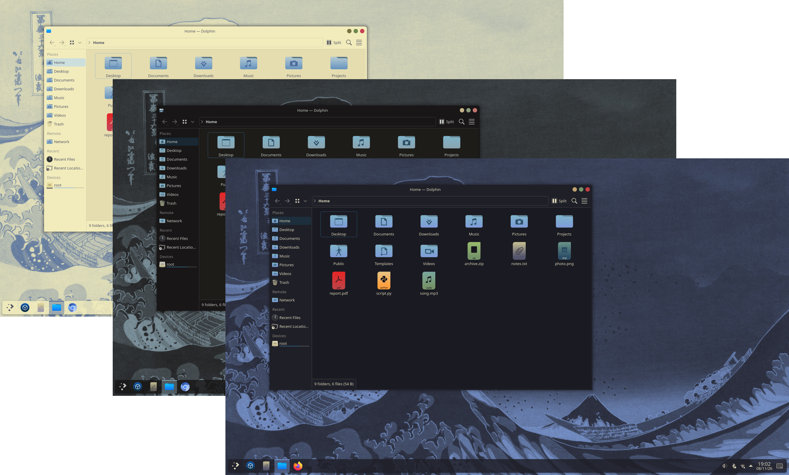
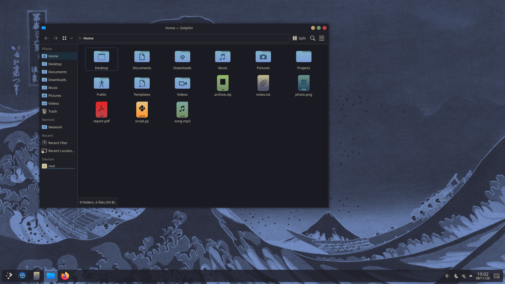
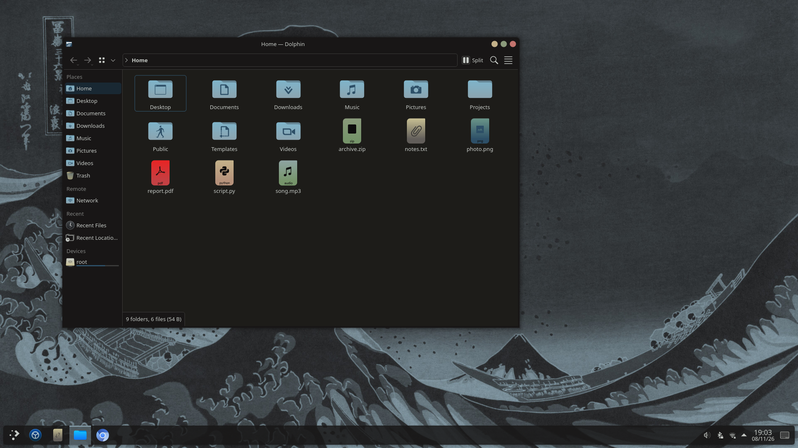
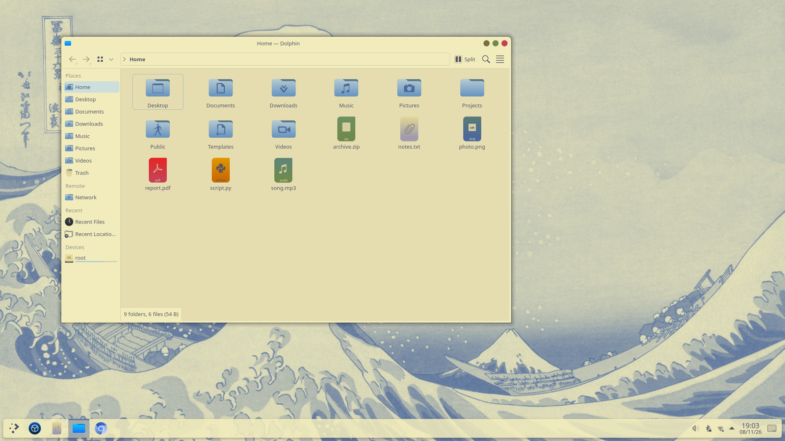

<h3>Kanagawa for <a href="https://kde.org/plasma-desktop/">KDE Plasma</a></h3>
<p>A community-maintained theme inspired by Hokusai's <em>The Great Wave off Kanagawa</em>.</p>
<p>Using the <a href="https://github.com/rebelot/kanagawa.nvim">Kanagawa palette</a> by <a href="https://github.com/rebelot">Tommaso Laurenzi (rebelot)</a>.</p>

<!-- Wave accents: carpYellow, crystalBlue, autumnRed. Lotus accents: lotusYellow, lotusBlue4, lotusRed. -->
<p>
  <a href="https://github.com/kanagawa-community/kde/stargazers">
    <picture>
      <source media="(prefers-color-scheme: dark)" srcset="https://img.shields.io/github/stars/kanagawa-community/kde?style=for-the-badge&amp;labelColor=1F1F28&amp;color=E6C384">
      <source media="(prefers-color-scheme: light)" srcset="https://img.shields.io/github/stars/kanagawa-community/kde?style=for-the-badge&amp;labelColor=F2ECBC&amp;color=77713F">
      
    </picture>
  </a>
  <a href="https://github.com/kanagawa-community/kde/releases/latest">
    <picture>
      <source media="(prefers-color-scheme: dark)" srcset="https://img.shields.io/github/v/release/kanagawa-community/kde?style=for-the-badge&amp;label=release&amp;labelColor=1F1F28&amp;color=7E9CD8">
      <source media="(prefers-color-scheme: light)" srcset="https://img.shields.io/github/v/release/kanagawa-community/kde?style=for-the-badge&amp;label=release&amp;labelColor=F2ECBC&amp;color=4D699B">
      
    </picture>
  </a>
  <a href="https://github.com/kanagawa-community/kde/issues">
    <picture>
      <source media="(prefers-color-scheme: dark)" srcset="https://img.shields.io/github/issues/kanagawa-community/kde?style=for-the-badge&amp;labelColor=1F1F28&amp;color=C34043">
      <source media="(prefers-color-scheme: light)" srcset="https://img.shields.io/github/issues/kanagawa-community/kde?style=for-the-badge&amp;labelColor=F2ECBC&amp;color=C84053">
      
    </picture>
  </a>
</p>

<br clear="both">
<br>

## Previews



<details>
<summary>🌊 Wave</summary>

</details>

<details>
<summary>🐉 Dragon</summary>

</details>

<details>
<summary>🪷 Lotus</summary>

</details>

## Requirements

- KDE Plasma 6, tested on 6.8. The window decoration uses KWin's
  `org.kde.kwin.aurorae.v2` plugin.
- For the login screen: [SilentSDDM](https://github.com/uiriansan/SilentSDDM), and
  optionally Monaspace Krypton NF installed system-wide (SilentSDDM falls back to
  its default font without it).

## Installation

Clone the repository and run the install script. It copies the color schemes, Plasma
styles, window decorations, global themes and wallpapers of all three variants into
`~/.local/share`:

```sh
git clone https://github.com/kanagawa-community/kde
cd kde
./install.sh
```

Run it again after `git pull` to update. `./uninstall.sh` removes exactly what it
installed. The login screen preset needs root, so it stays a manual step (see
[Login screen](#login-screen)).

## Usage

The port has five parts:

- Color scheme (`color-schemes/`): recolors Qt and KDE applications and the
  Breeze window titlebars.
- Plasma style (`desktoptheme/`): recolors the panel, widgets and popups. It
  uses the Breeze shapes.
- Window decoration (`aurorae/`): an Aurorae theme with rounded titlebars
  and colored dot buttons, which show their symbol on hover.
- Wallpapers (`wallpapers/`): 4K wallpapers, listed under
  [Wallpapers](#wallpapers).
- Global theme (`look-and-feel/`): applies all of the above, the
  [Kanagawa cursors](https://github.com/kanagawa-community/cursors) and
  [Kanagawa icons](https://github.com/kanagawa-community/icons) if installed, and
  Breeze for the application style. It sets the blue Great Wave
  wallpaper and does not change your panel layout.

Apply everything at once in **System Settings > Colors & Themes > Global Theme**,
or from a terminal:

```sh
plasma-apply-lookandfeel -a org.kanagawa-community.wave
```

For Dragon or Lotus, use `dragon` or `lotus` in place of `wave` here and below.

To apply only one part, pick it in System Settings, or run
`plasma-apply-colorscheme KanagawaWave` or
`plasma-apply-desktoptheme kanagawa-wave`. Pick the window decoration in
**System Settings > Colors & Themes > Window Decorations**.

Pick any of the wallpapers in **Desktop and Wallpaper** (right-click the
desktop, then **Configure Desktop and Wallpaper**).

### Login screen

`sddm/` has a preset for [SilentSDDM](https://github.com/uiriansan/SilentSDDM). With
SilentSDDM installed, copy the preset and its background into the theme, then select
the preset in its `metadata.desktop`:

```sh
theme=/usr/share/sddm/themes/silent
sudo install -m 644 sddm/kanagawa-wave.conf "$theme/configs/"
sudo install -m 644 wallpapers/kanagawa-wave-great-wave-dim/contents/images/3840x2160.jpg \
  "$theme/backgrounds/kanagawa-wave-great-wave-dim.jpg"
sudo sed -i 's|^ConfigFile=.*|ConfigFile=configs/kanagawa-wave.conf|' "$theme/metadata.desktop"
```

To preview it without logging out, run `./test.sh` from a copy of the theme folder.

For the cursors, install
[Kanagawa cursors](https://github.com/kanagawa-community/cursors). For the editor, install
[Kanagawa for Kate](https://github.com/kanagawa-community/kate). For the terminal, install
[Kanagawa for Konsole](https://github.com/kanagawa-community/konsole).

## Wallpapers

All wallpapers are 3840×2160, made from public-domain prints by Katsushika
Hokusai from his series _Thirty-six Views of Mount Fuji_. Each one is cropped to
the printed area.

| Wallpaper                             | Source                                                                                                                                          |
| ------------------------------------- | ----------------------------------------------------------------------------------------------------------------------------------------------- |
| The Great Wave off Kanagawa           | [The Met 39799](https://www.metmuseum.org/art/collection/search/39799), CC0                                                                     |
| The Great Wave off Kanagawa, restored | [Wikimedia Commons](https://commons.wikimedia.org/wiki/File:Great_Wave_off_Kanagawa2.jpg), a cleaned-up scan of The Met's JP1847, public domain |
| Red Fuji (South Wind, Clear Sky)      | [The Met 36490](https://www.metmuseum.org/art/collection/search/36490), CC0                                                                     |
| Kajikazawa in Kai Province            | [The Met 39800](https://www.metmuseum.org/art/collection/search/39800), CC0                                                                     |
| Reflection in Lake at Misaka          | [The Met 36495](https://www.metmuseum.org/art/collection/search/36495), CC0                                                                     |
| Umezawa Manor in Sagami Province      | [The Met 36501](https://www.metmuseum.org/art/collection/search/36501), CC0                                                                     |
| At Sea off Kazusa                     | [The Met 36502](https://www.metmuseum.org/art/collection/search/36502), CC0                                                                     |
| Tsukudajima in Musashi Province       | [The Met 36504](https://www.metmuseum.org/art/collection/search/36504), CC0                                                                     |
| Lake Suwa in Shinano Province         | [The Met 39798](https://www.metmuseum.org/art/collection/search/39798), CC0                                                                     |

Each variant also has versions of the restored Great Wave in its palette:

| Wallpaper | Colors                                                                                                                                                          |
| --------- | --------------------------------------------------------------------------------------------------------------------------------------------------------------- |
| Ink       | `ui.fg` lines on `ui.bg`                                                                                                                                        |
| Blue      | inverted, a `syn.fun` wave on `ui.bg`                                                                                                                           |
| Paper     | inverted, a `ui.fg_dim` wave on `ui.bg`                                                                                                                         |
| OLED      | the print's own colors; the sky, title and signature replaced by `ui.bg_m3`                                                                                     |
| Circle    | the wave in a circle, as printed and mirrored, its sky cut away, centered on one of `term.black` to `term.white`, or on true black (`#000000`) for OLED screens |
| Dim       | the full print under `ui.bg` at 70%, so light text reads over it; also the login screen background                                                              |
| Side      | the wave in a large circle on the left of `ui.bg_m3`, leaving the right empty                                                                                   |

## Palette

Every color comes from the shared
[palette](https://github.com/kanagawa-community/.github/blob/main/docs/PALETTE.md),
picked by role, so each variant uses its own value for the same role.

| Color set                      | Background / alternate          | Text / inactive text           |
| ------------------------------ | ------------------------------- | ------------------------------ |
| Window, Header                 | `ui.bg` / `ui.bg_m1`            | `ui.fg` / `ui.fg_dim`          |
| View                           | `ui.bg_m1` / `ui.bg`            | `ui.fg` / `syn.comment`¹       |
| Button                         | `ui.bg_p1` / `ui.bg_p2`         | `ui.fg` / `ui.fg_dim`          |
| Tooltip                        | `ui.float.bg` / `ui.bg_m1`      | `ui.float.fg` / `syn.comment`¹ |
| Complementary, inactive Header | `ui.bg_m3` / `ui.bg_dim`        | `ui.fg` / `ui.fg_dim`          |
| Selection                      | `ui.bg_search` / `ui.bg_visual` | `ui.pmenu.fg` / `ui.fg_dim`    |

Every set uses `syn.fun` for focus, hover and active text, `syn.special1` for
links, `syn.statement` for visited links, and `diag.error`, `diag.warning` and
`diag.ok` for negative, neutral and positive text.

The window decoration uses the Header colors for its titlebar. Its buttons use
`term.red` (close), `term.green` (maximize), `term.yellow` (minimize) and
`term.blue` (the others), with `ui.nontext` in inactive windows and
`ui.bg_p2` when disabled. The shadow is `term.black`.

Selection uses `ui.bg_search` rather than the style guide's `ui.bg_visual`,
because Plasma also uses the selection color as the accent on checkboxes and
sliders, where `ui.bg_visual` is too dark to see. Its text is `ui.pmenu.fg`, the
text of a selected menu item: `ui.fg` on `ui.bg_search` is below 4.5:1 in Lotus.

¹ In Lotus, `ui.float.fg_border`: `syn.comment` is 2.6:1 there, and the only role
that reaches 4.5:1 is darker than normal text.

## Accessibility

Tested pairs (WCAG contrast ratio). Values below 4.5:1 come from the shared palette.

| Pair                  | Wave   | Dragon | Lotus |
| --------------------- | ------ | ------ | ----- |
| Text on window        | 11.3:1 | 10.8:1 | 6.2:1 |
| Text on view          | 11.9:1 | 10.2:1 | 5.4:1 |
| Text on selection     | 6.0:1  | 6.0:1  | 5.5:1 |
| Tooltip text          | 9.8:1  | 10.6:1 | 5.8:1 |
| Inactive text on view | 3.5:1  | 3.9:1  | 3.7:1 |
| Error text on view    | 3.9:1  | 3.8:1  | 3.2:1 |

## Issues and contributions

Report bugs and request changes in this port's
[issue tracker](https://github.com/kanagawa-community/kde/issues). Contributions are welcome.

See [CONTRIBUTING.md](CONTRIBUTING.md) before opening a pull request.

## License

MIT. See [LICENSE](LICENSE).
